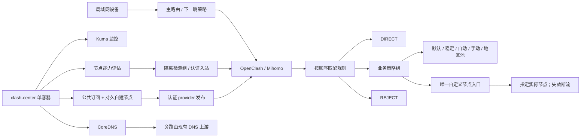

# Jydn OpenClash / Clash Stack

精细业务分流配置，以及集中运行监控、节点评估、订阅发布和 DNS 的单容器中心。提供中文离线安装向导、已有中心接管、备份和受控回退。

**配置版本、安装器版本和 OpenClash 插件版本分别管理。** 当前部署状态以[生产验收记录](docs/production-deployment-20261026.md)为准，不把历史设计稿当成已上线功能。

## 文档入口

| 需要做什么 | 文档 |
|---|---|
| 日常使用、选节点、订阅、自建节点、排障 | [系统使用与维护手册](docs/system-guide.zh-CN.md) |
| 管理页面逐项说明、按钮、指标与实际操作 | [管理页面完整操作手册](docs/management-pages.zh-CN.md) |
| 无订阅信息、IPv6 出口、节点数量与待修复项 | [当前问题与只读核验记录](docs/diagnostics-20261027.md) |
| 3103 清单内各订阅来源自动显示独立用量、状态及回退 | [自动用量显示说明与验收](docs/subscription-usage-auto-20261027.md) |
| 订阅更新、重启/重建后的恢复条件和 17 项隔离结果 | [订阅恢复验收与限制](docs/subscription-restore-acceptance-20261027.md) |
| 在其他局域网部署或接管已有单容器 | [安装器说明](installer/README.zh-CN.md) |
| 查看备份、安装中断与回退 | [恢复手册](installer/RECOVERY.zh-CN.md) |
| 查看测试范围、性能和未覆盖场景 | [安装器验收](installer/ACCEPTANCE.zh-CN.md) |
| 查看本次生产版本和验收证据 | [生产部署记录](docs/production-deployment-20261026.md) |
| 稳定自动补齐、系统总裁直连、数据库候选更新与回退 | [分流维护记录](docs/routing-maintenance-20261027.md) |
| 理解唯一自定义节点与故障断流 | [专属出口说明](docs/strict-custom-egress.md) |
| 仅用原有转换模板或维护规则 | [模板维护说明](docs/template-maintenance.zh-CN.md) |

## 运行结构

中心通过认证 API 读取运行图、操作获准入口和发布 provider，不替换 OpenClash 主程序。评估器 shadow 模式与已有专用控制器是不同模块，不能将其理解成整个系统完全只读。宿主机上的独立 Grok 切换任务不属于安装器自动迁移范围。

## 本环境与安装默认值

| 项目 | 本环境 | 其他局域网 |
|---|---|---|
| 中心主机 / 容器 | `10.88.0.249` / `clash-center` | 安装时填写 |
| Kuma / 能力 / 订阅页面 | `3101` / `3102` / `3103` | 可配置 |
| 旁路由 / 插件 | `10.88.0.254` / OpenClash `0.48.002` | 须通过插件及内核版本校验 |
| 活动配置 | `精准稳定-v1-r4-ha-subscription-managed.yaml` | 接管保留原配置，全新安装生成本站点配置 |
| 运行规则图 | 103 个配置组，API 含 GLOBAL 共 104 个组，144 条规则 | 随实际配置变化 |
| 中心 DNS | 保留现有 `53/TCP+UDP` 和上游 | 全新向导默认不发布，不自动改 DHCP |

实际安装器版本及验收时间见部署记录。仓库与安装包不含真实密码、订阅 Token、节点密钥或生产数据库。

接管后的独立配置维护已补齐 75 个业务/功能选择组的 `🛟 稳定自动`，保留原选择，并将系统总裁官方域名直连。新增四库候选收集每 6 小时自动更新、校验，仍为隔离试跑；原生产数据库每日更新保留。该增量未重新打包进已发布的 0.1.1 ZIP，详见[维护记录](docs/routing-maintenance-20261027.md)。

## 主要能力

- **分流**：业务独立选择出口，规则按实际顺序匹配；国内、海外及用户例外分别验证。
- **节点判断**：分开记录延迟、通用联网、业务响应、失败类型和结果时效。低延迟不证明业务可用，403/429 也不一律算成功。
- **订阅**：支持空来源、单来源和多来源；公共源经受控准入发布，异常不直接覆盖已验收版本。空来源不代表代理或 DNS 已可用。
- **来源入口边界**：当前自动用量识别以 3103 的来源清单为准；OpenClash“编辑配置文件订阅信息”中的“转换”等订阅项不会自动导入这份清单。在另一个入口新增地址，不代表受管配置已增加该来源，详见[来源边界](docs/subscription-restore-acceptance-20261027.md#来源入口不自动互相导入)。
- **套餐用量**：3103 自动识别启用的公共来源，新增、停用、删除自动反映到独立卡片和 OpenClash 当前配置卡片；单来源失败独立退避，有历史值时明确标记缓存，无历史时显示未获取。当前两家已实际验收，节点拉取地址、DNS 和业务选择未改。详见[说明与恢复](docs/subscription-usage-auto-20261027.md)；该增量不包含在原 0.1.1 ZIP 内。
- **机场名称与 N 来源适配**：自动解析供应商标题及编码文件名，避免把 `source-1` 当作真实机场名；支持手动显示名优先，改订阅地址不继承旧账户名称。0～128 个来源、增删重排、限流/超时与页面缓存已扩展验收，详见[名称修正与通用回归记录](docs/subscription-usage-names-acceptance-20261027.md)。
- **订阅恢复**：17 项隔离验收通过，覆盖更新、进程重启、容器重启/保留数据卷重建及 128 来源热缓存恢复。须保留来源清单、缓存、认证和启动挂载；缓存恢复不等于重新联网成功。坏缓存且上游离线时显示未获取，生产中心未重启，详见[恢复条件和未覆盖范围](docs/subscription-restore-acceptance-20261027.md)。
- **自建节点**：3103 粘贴链接、预览校验并发布，独立持久化；公共订阅更新不重建自建数据。OpenClash 只保留一个 `🔐 自定义节点`，各业务按需引用。
- **恢复**：在线 SQLite 备份、固定镜像及文件散列、身份核验、双端事务和独立限时回退。接管不借升级改写旁路由业务规则或 DNS。

## 安装与更新

**0.1.1 离线发行版：** [下载页面与发行说明](https://github.com/zhiwen1987/Jydn-openclash/releases/tag/v0.1.1) · [完整安装包](https://github.com/zhiwen1987/Jydn-openclash/releases/download/v0.1.1/Clash-Stack-0.1.1-x64.zip) · [SHA-256 校验文件](https://github.com/zhiwen1987/Jydn-openclash/releases/download/v0.1.1/Clash-Stack-0.1.1-x64.zip.sha256.txt)。Release 中的 Source code 是仓库源码，不包含镜像与随包依赖，不能代替完整安装包。

先核对[前置条件](installer/README.zh-CN.md)，完整解压可信离线包；Windows 运行 `开始安装.cmd`，Linux 运行 `sh install.sh`。源码仓库不是包含镜像及依赖的发行包，不提供未经核验的网络下载执行命令。

已有中心选择接管：先 doctor、plan，核对备份与恢复后执行。Compose 覆盖文件、外部代码挂载、Kuma 版本差异或设备身份变化必须先审阅，不要删除保护强行覆盖。相同版本、相同档案重复安装只做验证。

这是应用层安装器，不刷固件、不拨号、不操作 ESXi、爱快或 Windows 应用/代理/DNS。新环境仍需自行接好主路由、网关及 DHCP。

## 限制与历史资料

一个容器和一台旁路由仍有单点。升级中心会短暂停顿 Kuma/DNS 等服务，不保证零中断，不承诺“八个 9”。HTTP/DNS 检查不能代替 App 登录、真实对话、支付与全部外网业务验收。

自定义出口约束实际命中所选业务组的流量。`gstatic.com` 等资源可能先命中更高优先级规则；Google、Gemini、YouTube 分别选择，不等于自动锁定整个 Google 域名族。

历史参考：[R4 设计](docs/precise-stable-r4-ha-design.md)、[旧版 v0.47.156 设置](docs/openclash-v0.47.156-settings.md)、[单臂旁路由说明](docs/istoreos-openclash-one-arm-router.md)。其中历史组数、容器数量与参数不能直接当作当前生产状态。
