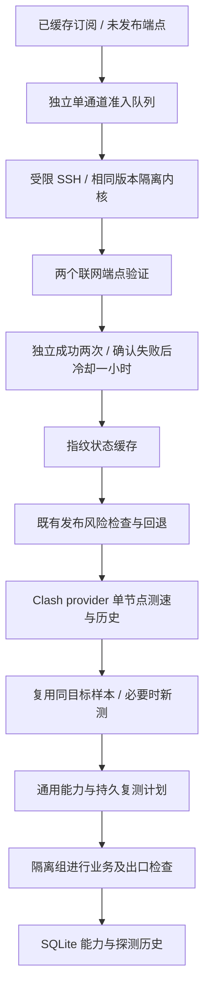

# 节点健康检测与 Clash 协同维护

维护日期：2026-10-28（本机北京时间；证据保留各设备自己的时间戳）。这是节点检测增量，不是更换分流模板或升级内核。

## 现在如何判断节点

1. 基础测速读取 Clash 内真实 provider 节点的 HTTPS HEAD 结果，优先复用同一个明确目标、300 秒内的成功历史。需要新样本时调用该真实节点的单节点健康接口。
2. 首次失败进入复核；三次间隔至少 10 秒的真实失败确认故障。确认后冷却 **3600 秒**，到期重新入队；未配置永久黑名单。初始复核计划为 30、60 秒，到期表示可调度，不保证在队列繁忙时立刻完成。
3. 恢复需要两个独立成功样本，重复读取同一条历史不会增加成功次数。冷却期间即使外部观察到成功，也不提前解除冷却。
4. `busy`、SSH 故障、内核版本不匹配、检测接口异常和测试内核未就绪属于检测设施故障，不累加成节点故障，不把旧成功时间刷新成“刚刚成功”。设施恢复后继续重试。
5. 通用联网与业务能力分别记录。基础测速通过不证明 ChatGPT、Gemini、Grok 登录或账户操作可用，业务探测继续检查自身的状态和内容。

## 与 Clash 怎样协同



基础测速不调用会清除固定选择的 `group/delay`，不通过切换共享节点完成。业务和出口检查仍只使用已有的隔离检测组，并保持路由所有权锁。业务质量控制补充轮换候选，保留当前出口、防抖、手动选择和严格自定义出口限制；不会因这次维护把所有业务统一切到一个节点。

多节点、跨来源集中失败时，会追加已知可用节点的独立复核；参考也失败时暂停主动评估 60 秒，避免检测设施或公共目标故障引发批量误判。这是保护措施，不是能完全识别所有公共故障的保证。

## 测速数值的准确含义

- 直接保存内核返回的毫秒值；不把容器到路由器的 API 往返时间当节点延迟。
- 当前固定内核的 URLTest 使用 HEAD；启用 unified-delay 时可能记录第二次请求。它不是 ICMP ping，也不是下载带宽。
- 通用节点 API 不返回真实业务 HTTP 状态，因此不会凭成功延迟伪造 `204`。业务 HTTP 检查另行保存实际结果。
- 失败没有有效延迟，页面显示“未取得”，不将超时时间当作成功延迟。API 附带测速来源、样本时间、复测计划，以及有效样本的中位数；至少 20 个有效样本才输出 P95。
- 新测备用目标与原目标是不同采样条件，不能把不同站点、不同时间的数值要求为完全相同。该指标用于辅助判断，不代替业务验证。
- 保留的旧 HTTP 检测记录标记为 `legacy_http`，经过新口径实际检测后才标记为 `Clash HTTPS HEAD`；不会把尚未重测的旧数值改称原生 HEAD。队列滚动更新期间，两种记录会暂时共存。

实现依据：[固定提交的 URLTest](https://github.com/MetaCubeX/mihomo/blob/daf3ad03021cca6031f4a7303ca6d861a14d5a16/adapter/adapter.go)、[固定提交的 provider 路由](https://github.com/MetaCubeX/mihomo/blob/daf3ad03021cca6031f4a7303ca6d861a14d5a16/hub/route/provider.go)。升级内核必须重新验证接口与语义，不直接套用其他版本的说明。

## 自动复测与资源约束

准入与订阅拉取/发布分开：后台线程只读取已有节点来源的缓存文件，不主动抓取订阅，不直接发布节点或改变策略。一次只启动一个准入任务，两次任务至少间隔 30 秒；根据持久的到期时间公平轮换。订阅更新仍由既有发布流程负责。

新增一个 Python 线程，无新增容器。业务探测维持原有串行所有权，未盲目增加并发。准入子进程关闭不应继承的文件描述符，不再将锁传给测试内核；独立租约限制测试内核运行时间为 50 秒，即使 SSH 父进程被强杀也会清理测试进程。启动等待有独立的 8 秒预算，避免繁忙时误报未就绪。检测期间可能短暂增加 CPU、网络和文件 I/O，并非零成本。

修改 OpenClash“转换”中的信息来源，仍只同步名称与用量，不自动加入节点发布清单。这次节点队列读取原节点来源，不能把“第三家用量显示成功”当成第三家节点已发布。

## 持久数据与重启

本环境控制目录为 `/root/dpanel/compose/lan-center/data/failover`，对应容器 `/data`：

| 位置 | 内容 |
|---|---|
| `node-capability.db` 的 `probe_schedule` | 每个节点、业务的复测、成功/失败连续样本与冷却时间 |
| `subscription-controller/admission-cache.json` | 未发布端点的指纹及准入状态，不保存节点凭据 |
| `node-health/admission-clock.json` | 准入调度时钟 |
| `node-health/code/` | 本次代码增量；当前生产镜像未重建 |

进程重新加载后读取这些数据，继续冷却和复测。整个数据卷丢失、时钟大幅跳变、磁盘损坏、密钥丢失或核心升级，不属于“自动恢复一切”；应核对备份、可信时钟、固定主机公钥和内核散列。内核散列变化时受限准入应停止并报告设施错误，不自动信任新二进制。

## 验收范围

完整脱敏结果见[本次验收证据](evidence/node-health-20261028.json)。

隔离验收覆盖首次失败、三次确认、一小时到期、失败复测、两次成功恢复、重复缓存不重复计数、锁忙重试、损坏缓存保护、数据库重新打开、原生毫秒值保存、控制接口故障、跨来源失败保护，以及增量回退和后续人工修改保护。**一小时边界用可控时钟验证，没有将短测试冒充生产真实等待一小时。**

生产验收包括：真实受限 SSH 准入的两个端点、后台队列真实任务推进、内核 API 数值与对应历史一致、SQLite 检查、原 43 个活动节点身份及历史保留、84 个业务选择、规则定义、源/运行配置、DNS、节点拉取地址、容器身份/启动时间和 DNS/Kuma 进程。UDP/TCP DNS 查询另行实际验证。后台抽到的故障节点仍进入复核，没有为了“通过”强行发布。

生产未注入节点断网故障，未重启生产容器或主机，也未证明全部节点、全部业务和账户长期可用。隔离测试通过不代表消灭所有故障，更不代表 99.999999% 端到端可用率。

放行后抽样，检测服务正常，3 家用量均为 `ok`，原业务选择未变。准入队列已更新 19 个指纹记录，旧 `busy` 记录从 43 个降至 27 个，更新后的记录没有新增 `busy`；这些是当时样本，不是固定数量。发布控制器仍报告既有的 `degraded / same_as_current`，HTTP 健康接口可用，继续保留当前发布，没有为了清除告警强推候选。余下旧缓存和真实不可达节点继续按队列复测，不能据此宣称所有节点已恢复。

## 备份和回退

- 249：`/var/backups/clash-node-health-1793118412/`，含原代码、状态、在线 SQLite 备份、散列和恢复工具。
- 254：`/root/clash-stack-backups/node-health-1793118409/`，含配置、内核、受限准入文件和恢复工具。已确认旧孤儿进程的文件也私有保存。

备份含敏感信息，只在受信 SSH 终端使用，不上传 GitHub。先在 **249** 执行代码回退，停止新增队列，再在 **254** 回退准入执行器：

```sh
# 249，root 权限
python3 -B /var/backups/clash-node-health-1793118412/node_health.py check /var/backups/clash-node-health-1793118412
python3 -B /var/backups/clash-node-health-1793118412/node_health.py rollback /var/backups/clash-node-health-1793118412
```

```sh
# 254，root 权限
ruby /root/clash-stack-backups/node-health-1793118409/node_health_router.rb /root/clash-stack-backups/node-health-1793118409/helpers.rb check /root/clash-stack-backups/node-health-1793118409
ruby /root/clash-stack-backups/node-health-1793118409/node_health_router.rb /root/clash-stack-backups/node-health-1793118409/helpers.rb rollback /root/clash-stack-backups/node-health-1793118409
```

恢复工具检测到这些文件后续被他人修改时拒绝覆盖，需要先审查。回退只重新加载检测/订阅两个进程，保留发布指针、数据库和新增探测历史；不重启容器、DNS、Kuma 或 Clash。不会复活旧孤儿进程，也不要手工恢复旧在线数据库来撤销代码。若未来合法更新了受管文件或中心身份，不能绕过保护照抄本次命令。

每端部署均有独立 20 分钟未确认回退守卫，验收确认后退出；它不是日常重启或断电灾备。当前代码已同步仓库，已发布的 **0.1.1 ZIP 未重新打包**，下载旧 ZIP 不包含本次增量。
